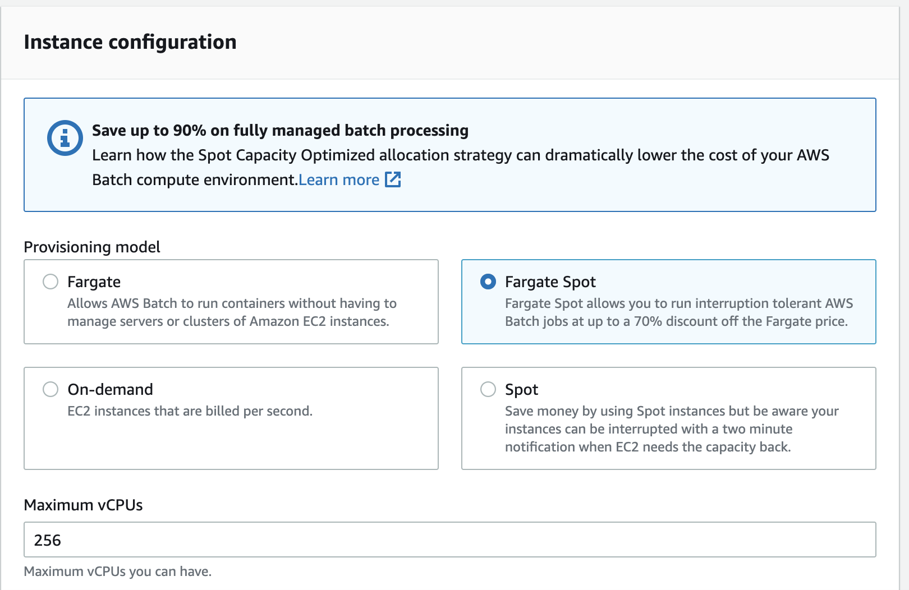
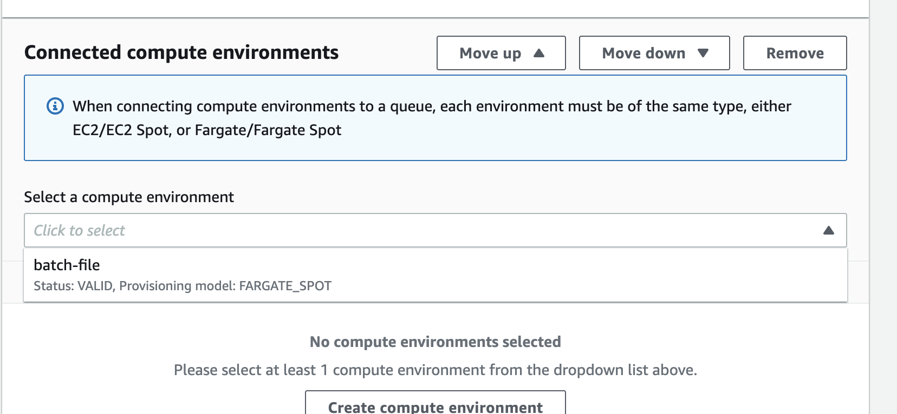
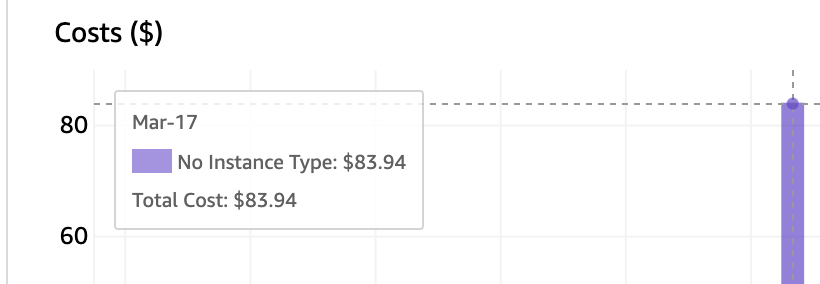

# The problem: Time and Money

My goal was to OCR about 3.5 million documents. To achieve this there were two major issues:

### Cost

Top of the line managed OCR, like Google Cloud Vision can get pretty pricey at this scale. At about $1.50/1000 pages, this process could cost about $30,000 or more on Google’s service.

### Speed

To use an open source software, like tesseract, is incredibly slow to run on a single machine. On a running server ($) this process would have taken about 6 months on a single node.

# The Options

### SQS + ECS 

The first solution to this problem was to create a queue of tasks and ship them to a cluster of ECS tasks. Having not much experience with queueing, this would involve the manual process of creating a processing queue, connecting it to ECS, monitoring the queue and configuring things like retry functions. To achieve my goal of high-volume scaling, this would also involve learning how to tie ECS task count to SQS queue length. Something worth learning, but I wanted to feel confident in the autoscaling configurations.

### AWS Batch

I am generally skeptical of AWS managed products, but this is exactly what I was looking for. A tool that integrates both SQS ECS seamlessly together. The best part is the scaling, simple resource configuration, and easy selection of spot instances for cost savings.

# How

Follow along with the app that I made [here](https://github.com/jdelorimier/seamless-file-process)

## Step 1: Create app and Docker file

One should be familiar with the fundamentals of making a docker app. In my case here was the `Dockerfile` for the app. As an aside, I really enjoyed the experience of using the very good [Poetry dependency manager](https://python-poetry.org/).



## Step 2: Push Docker image to ECR
There are a couple prerequisite steps that go into this, but it is very easy to set up a ECR repo in your aws account. After that one only needs to run a couple simple scripts to build and push a docker image to the repository.



## Step 3: Create AWS Batch compute environment (CONSOLE)

Getting into the meat of AWS Batch itself, it is pretty easy to do in the AWS console, but after an initial trial run, I found it much faster to iterate on versions using the boto3 python package.

1. Name environment. link role

2. Use Fargate Spot

That's it!

## Step 4: Create AWS Batch job queue (CONSOLE)

A very simple initial configuration:
1. Name queue
2. Connect to your previously created compute environment

## Step 5: Register Batch job definition (Boto3)

This is probably the trickiest part. The core attributes of the job definition are: 

1. Attach IAM role associated with the job
2. Environment variable for your container. I think this is the easiest way to pass parameters from the queue to the application.

Optional: Retry strategy and container configuration also available.

My script for configuring job definition [found here](https://github.com/jdelorimier/seamless-file-process/blob/main/config/register_job.py)



## Step 6: Submit Batch job for execution (Boto3)

My script for iterating on my target bucket and submitting objects to the batch processor. What this script does is iterate over a target s3 bucket and create items in the job queue for processing. Importantly, this is where environment variables are passed to the docker container.



# Results

## Speed 

The entire batch process took less than 2 days.

## Cost

Using spot instances, the total cost was less than $100.

